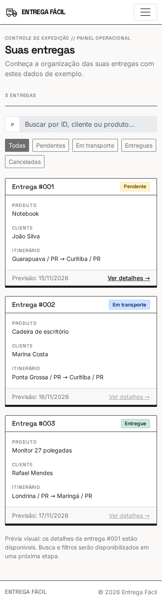
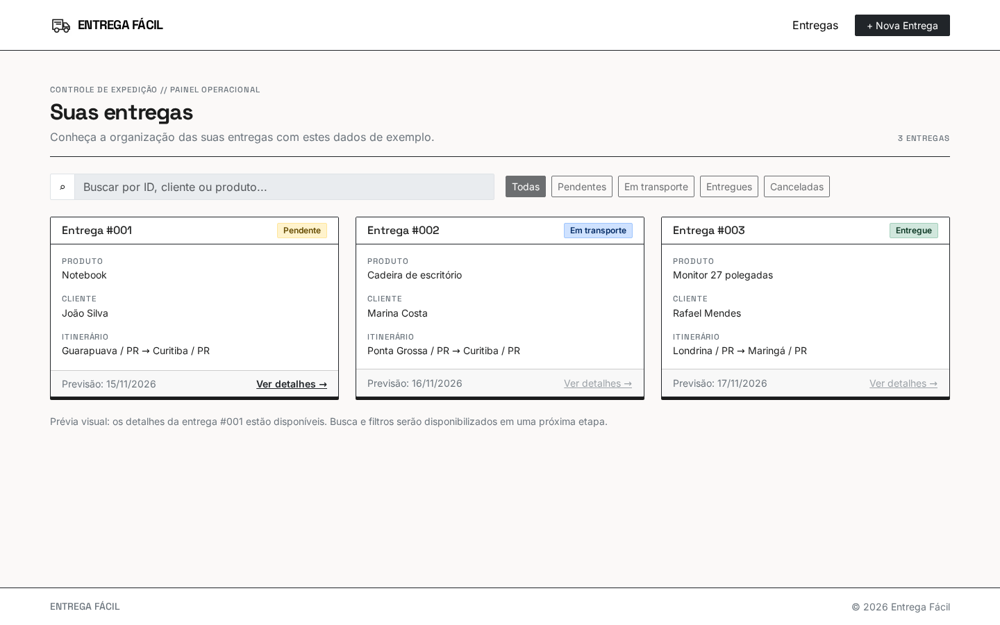
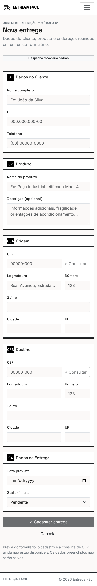
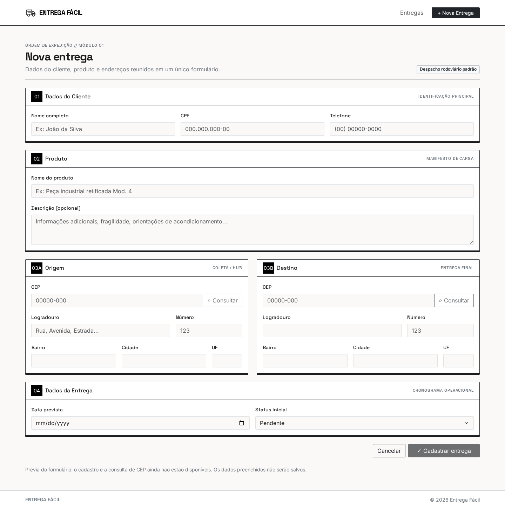
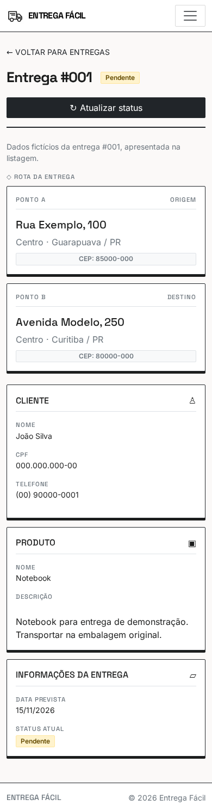
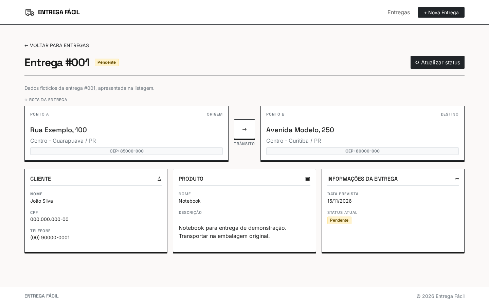

# entrega-facil

### Autor: Lucas Brugge de Almeida

O Entrega Fácil é uma aplicação web para cadastro e acompanhamento de entregas.
Esta versão apresenta a **casca da 2ª entrega**: listagem, cadastro e detalhes em
três páginas HTML responsivas, com Bootstrap e Sass.

Os exemplos estão escritos no HTML. A navegação, o menu responsivo e o modal
Bootstrap funcionam. Busca, filtros, cadastro, consulta de CEP e atualização de
status permanecem como apresentação visual, sem gravações. APIs, CRUD, validações,
jQuery e armazenamento no navegador ficam para a 3ª entrega.

## 📚 Documentação do Projeto

- [📄 Product Requirements Document (PRD)](docs/prd.md) — Escopo e histórias de usuário da 1ª entrega.
- [🛠️ Arquitetura da Aplicação](docs/architecture.md) — Modelo de dados, tecnologias e integrações previstas na 1ª entrega.

Os dois documentos permanecem integralmente preservados. Descrevem a proposta
completa, incluindo funcionalidades que não fazem parte desta casca.
[docs/validacao-tecnica.md](docs/validacao-tecnica.md) é um registro histórico
de outubro; seus testes e comandos de API não descrevem a versão atual.

## 🎨 Design

- 🎨 [Design System aplicado e tokens da casca](sdd.md) — Complemento técnico, sem modificar a arquitetura original.
- 🖼️ Protótipo no Figma/Stitch — [Páginas](https://stitch.withgoogle.com/projects/2737167932936789921)

## 🌐 Site em Produção - GitHub Pages

A partir da Entrega 3.

## 💻 Tecnologias e Dependências

- **Bootstrap 5.3.8:** grid, cards, campos, botões, badges, navbar e modal.
- **Sass:** tokens, mixin reutilizado, função de espaçamento e estilos por página.
- **Node.js e npm:** gerenciamento das dependências e ferramentas de desenvolvimento.
- **ESLint e Prettier:** verificação dos scripts e padronização do código.

Bootstrap, suas licenças, CSS compilados e imagens acompanham o projeto.
Google Fonts carrega Inter e Space Grotesk pela internet, com fontes alternativas.
ViaCEP e JSON Server continuam previstos nos documentos originais para a etapa
de comportamento; não são dependências desta versão.

## ✅ Checklist | Indicadores de Desempenho (ID) dos Resultados de Aprendizagem (RA)

Os enunciados abaixo foram preservados literalmente de `6ddf6c9df7`.
As marcações comprovadas da 1ª entrega (**01, 15, 16 e 17**) foram preservadas.
Os IDs **02–10, 15 e 16** estão implementados na casca da 2ª entrega e marcados
com referências ao código atual. A defesa técnica deve explicar o conceito,
a aplicação e o efeito de retirar cada recurso.

No commit histórico, 18 e 19 estavam marcados, mas a evidência era incompleta:
18 tinha apenas a separação de documentos em `docs/`; 19 não tinha configuração
de linter ou formatador. Os IDs **13, 18 e 19** agora estão marcados pelas
evidências da versão atual, como requisitos antecipados da 3ª entrega, sem
atribuir essas implementações à 1ª entrega. Eles não integram os 11 IDs avaliados
na 2ª entrega; o 17 permanece como registro histórico.

#### RA1 - Utilizar Frameworks CSS para estilização de elementos HTML e criação de layouts responsivos.

- [x] ID 01 - Prototipa interfaces adaptáveis para no mínimo os tamanhos de tela mobile e desktop, usando ferramentas de design tradicionais (Figma, Quant UX ou Sketch) ou IA (Stitch).
      Referências: [protótipo mobile e desktop](https://stitch.withgoogle.com/projects/2737167932936789921).
- [x] ID 02 - Implementa layout responsivo com Framework CSS (Bootstrap, Materialize) usando Flexbox ou Grid do próprio framework.
      Referências: [app/index.html:107–142](app/index.html#L107-L142) — grid Bootstrap com `row`, `col` e `row-cols-*`.
- [x] ID 03 - Implementa layout responsivo com CSS puro, usando Flexbox ou Grid Layout.
      Referências: [assets/scss/cadastro.scss:5–15](assets/scss/cadastro.scss#L5-L15) — Grid próprio com uma coluna e media query para duas; [aplicação no HTML](app/pages/cadastro/index.html#L166-L179).
- [x] ID 04 - Utiliza componentes prontos de um Framework CSS (ex.: card, button) e componentes JavaScript do framework (ex.: modal, carousel).
      Referências: [card](app/index.html#L112-L142), [menu recolhível](app/index.html#L41-L57), [acionador do modal](app/pages/detalhes/index.html#L75-L82) e [modal com bundle Bootstrap](app/pages/detalhes/index.html#L188-L256).
- [x] ID 05 - Cria layout fluido usando unidades relativas (vw, vh, %, em, rem) no lugar de unidades fixas (px).
      Referências: [assets/scss/main.scss:27–45](assets/scss/main.scss#L27-L45) — `rem`, `em` e `vw`; [gap relativo do cadastro](assets/scss/cadastro.scss#L5-L14).
- [x] ID 06 - Aplica um Design System consistente (cores, tipografia, padrões de componentes) em toda a aplicação.
      Referências: [tokens documentados](sdd.md#L10-L23), [variáveis Sass](assets/scss/_variables.scss#L1-L8) e [aplicação compartilhada](assets/scss/main.scss#L8-L25).
- [x] ID 07 - Utiliza Sass (SCSS) com ou sem framework, aplicando variáveis, mixins e funções para modularizar o código.
      Referências: [variáveis](assets/scss/_variables.scss#L1-L8), [mixin square-size](assets/scss/_mixins.scss#L1-L5), [função space](assets/scss/_functions.scss#L1-L6), [usos no estilo comum](assets/scss/main.scss#L32-L51) e [reuso do mixin no cadastro](assets/scss/cadastro.scss#L17-L22).
- [x] ID 08 - Aplica tipografia responsiva (media queries mobile first) ou tipografia fluida (função clamp() + unidades relativas).
      Referências: [assets/scss/main.scss:27–40](assets/scss/main.scss#L27-L40) — tipografia fluida da marca e do título com `clamp()`.
- [x] ID 09 - Aplica técnicas de responsividade de imagens usando CSS (object-fit, containers com unidades relativas).
      Referências: [assets/scss/main.scss:32–35](assets/scss/main.scss#L32-L35) — tamanho relativo e `object-fit: contain`; [imagem com img-fluid](app/index.html#L27-L39).
- [x] ID 10 - Otimiza imagens usando formatos modernos (WebP) e carregamento adaptativo (srcset, picture, ou parâmetros do Cloudinary).
      Referências: [app/index.html:27–39](app/index.html#L27-L39) — WebP com `srcset` de 32/64/96px e `sizes="2rem"`, adaptado principalmente à densidade de pixels.

#### RA2 - Realizar tratamento de formulários e aplicar validações customizadas no lado cliente.

- [ ] ID 11 - Implementa validação HTML nativa (campos obrigatórios, tipos, limites de caracteres) com mensagens de erro/sucesso no lado cliente.
- [ ] ID 12 - Aplica expressões regulares (REGEX) para validações customizadas (e-mail, telefone, datas, etc.)
- [x] ID 13 - Utiliza elementos de seleção em formulários (checkbox, radio, select) para coleta de dados.
      Referências: [app/pages/cadastro/index.html:327–334](app/pages/cadastro/index.html#L327-L334) — `select` de status com `name`, opções e valor inicial, dentro do formulário. A seleção funciona; envio e gravação permanecem desativados nesta casca.
- [ ] ID 14 - Implementa leitura e escrita no Web Storage (localStorage/sessionStorage) para persistir dados localmente.

#### RA3 - Aplicar ferramentas para otimização do processo de desenvolvimento web.

- [x] ID 15 - Configura ambiente com Node.js e NPM para gerenciamento de pacotes e dependências.
      Referências: [dependências e versão de Node](package.json#L22-L34), [comandos npm](package.json#L5-L10) e [lockfile](package-lock.json).
- [x] ID 16 - Utiliza boas práticas de versionamento no Git/GitHub (branch main ou branches específicos, uso de .gitignore).
      Referências: [.gitignore:1–2](.gitignore#L1-L2) — exclusão de `node_modules` e `.env`; [histórico da simplificação](https://github.com/lucasbrugge/entrega-facil/commits/main).
- [x] ID 17 - Mantém um README.md padronizado, conforme template da disciplina, com checklist preenchido.
      Referências: [README da 1ª entrega](https://github.com/lucasbrugge/entrega-facil/blob/6ddf6c9df7/README.md) e seções deste README com documentação, checklist e execução. Marcação histórica, fora dos 11 IDs avaliados na 2ª entrega.
- [x] ID 18 - Organiza arquivos do projeto de forma modular, seguindo padrão de exemplo fornecido.
      Referências: [listagem e seu CSS](app/), [cadastro](app/pages/cadastro/), [detalhes](app/pages/detalhes/) e [parciais Sass](assets/scss/); [destinos da compilação por página](package.json#L5-L7). HTML e CSS específico ficam juntos; recursos compartilhados ficam em `assets/`.
- [x] ID 19 - Configura linters e formatadores (ESLint, Prettier) para manter qualidade e padronização do código.
      Referências: [configuração ESLint](eslint.config.cjs#L1-L9), [configuração Prettier](.prettierrc.json#L1-L5), [exclusões de formatação](.prettierignore#L1-L6) e [comandos npm](package.json#L8-L10). Ambos foram executados com sucesso; nesta casca, o ESLint analisa a própria configuração, pois não há JavaScript próprio da aplicação.

#### RA4 - Aplicar bibliotecas de funções e componentes em JavaScript para aprimorar a interatividade de páginas web.

- [ ] ID 20 - Utiliza jQuery para manipulação do DOM e interatividade (eventos, animações, manipulação de elementos)
- [ ] ID 21 - Integra e configura um plugin jQuery relevante (ex.: jQuery Mask Plugin) ou outra biblioteca de funções.

#### RA5 - Efetuar requisições assíncronas para uma API fake e APIs públicas, permitindo a obtenção e manipulação de dados dinamicamente.

- [ ] ID 22 - Realiza requisições assíncronas para uma API fake (ex.: JSON Server) para persistir dados de um formulário.
- [ ] ID 23 - Realiza requisições assíncronas para uma API fake para exibir dados na página.
- [ ] ID 24 - Realiza requisições assíncronas para APIs públicas reais (OpenWeather, ViaCEP etc.), exibindo os dados e tratando erros.

### Referências dos indicadores

As referências junto de cada indicador apontam para os arquivos e linhas atuais.
Depois da publicação e da criação da tag da entrega, o mapa do Moodle deve usar
links definitivos em `blob/entrega-2/`, conferindo novamente os intervalos.
A tag ainda não foi criada; as referências atuais não representam links dessa tag.

### Organização e origem das telas

```text
app/
  index.html
  entregas.css
  pages/cadastro/
    index.html
    cadastro.css
  pages/detalhes/
    index.html
    detalhes.css
assets/
  css/
  scss/
  images/
  vendor/
docs/
```

Os três HTML foram recuperados seletivamente de `c5048275ab`, conferidos e
adaptados para conteúdo estático. O Sass enxuto, as imagens e o Bootstrap local
foram reaproveitados da `main` em `525a647`. O histórico permanece acessível.

Referências: [modelo de README](https://github.com/utfpr-gp/roubank-css) e
[organização por páginas](https://github.com/utfpr-gp/joao-lenao--gerador-relatorio-medico).

## 🚀 Manual de execução

Requer Node.js **20.19+, 22.13+ ou 24+**, npm e a extensão **Live Server** do VS Code.

Clone o projeto publicado:

```bash
git clone https://github.com/lucasbrugge/entrega-facil.git
cd entrega-facil
npm install
```

Na cópia de trabalho atual, basta executar `npm install` na raiz. No VS Code,
abra **app/index.html**, clique com o botão direito e escolha **Open with Live
Server**. A página inicial é **app/index.html**; mantenha a raiz inteira do
projeto aberta no editor para os caminhos de `assets/` funcionarem.

A listagem contém o link **Ver detalhes** da entrega #001. Nos detalhes, use
**Nova Entrega** para abrir o cadastro e **Cancelar** para retornar à listagem.
No celular, esses links também estão disponíveis pelo menu recolhível.

Os estilos compilados e o Bootstrap já acompanham a versão. Não é necessário
executar Sass ou uma API para abrir as páginas.

### Desenvolvimento

```bash
npm run sass:build
npm run sass:watch
npm run lint
npm run format:check
```

Edite `assets/scss/`. O Sass gera o estilo compartilhado em `assets/css/main.css`
e os estilos específicos em `app/entregas.css`, `app/pages/cadastro/cadastro.css`
e `app/pages/detalhes/detalhes.css`. Preserve os CSS compilados junto do código-fonte.
`npm run format` formata os arquivos de trabalho, preservando `docs/`, bibliotecas,
CSS compilados e lockfile.

## 📱 Telas da aplicação

- [Listagem de entregas](app/index.html)
- [Cadastro](app/pages/cadastro/index.html)
- [Detalhes da entrega](app/pages/detalhes/index.html)

Abra as páginas pelo Live Server conforme o manual acima.

Capturas reais da versão de trabalho: celular **390px** e desktop **1440px**,
com viewport de 900px de altura; imagens de página inteira.

### Listagem — celular (390px)



### Listagem — desktop (1440px)



### Cadastro — celular (390px)



### Cadastro — desktop (1440px)



### Detalhes — celular (390px)



### Detalhes — desktop (1440px)



Abra cada imagem para ler em tamanho completo. O cadastro tem captura mais alta,
pois reúne o formulário inteiro. Dados de exemplo fictícios.

Preparação: [mapa provisório](mapa-entrega-2.md), [tópicos do vídeo](roteiro-entrega-2.md)
e [origem das capturas e testes](evidencias/entrega-2/README.md).
